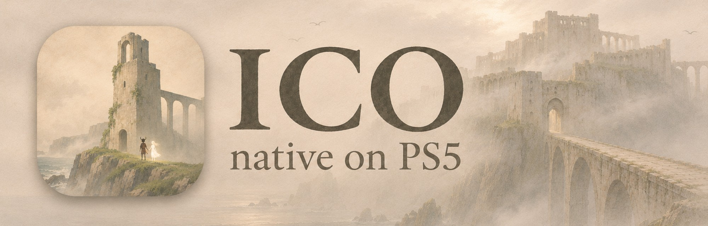
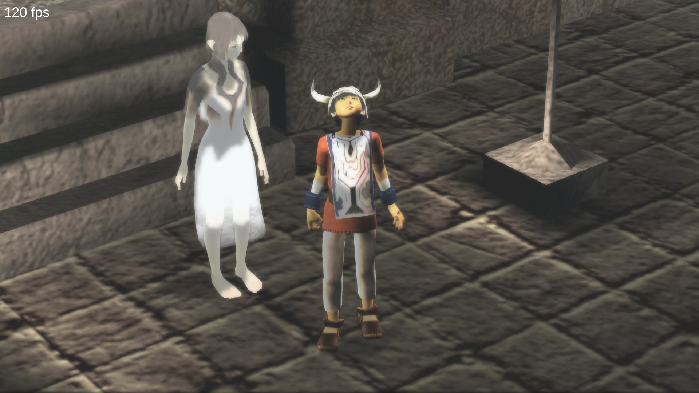
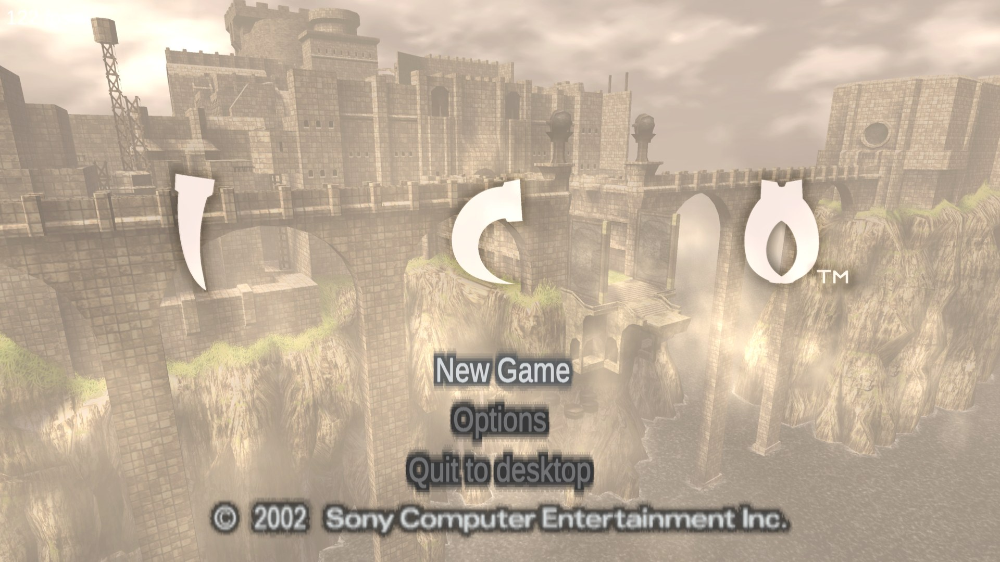
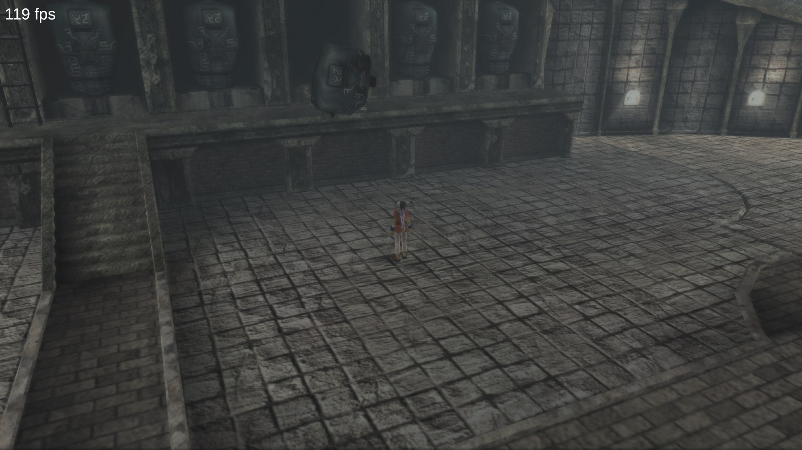
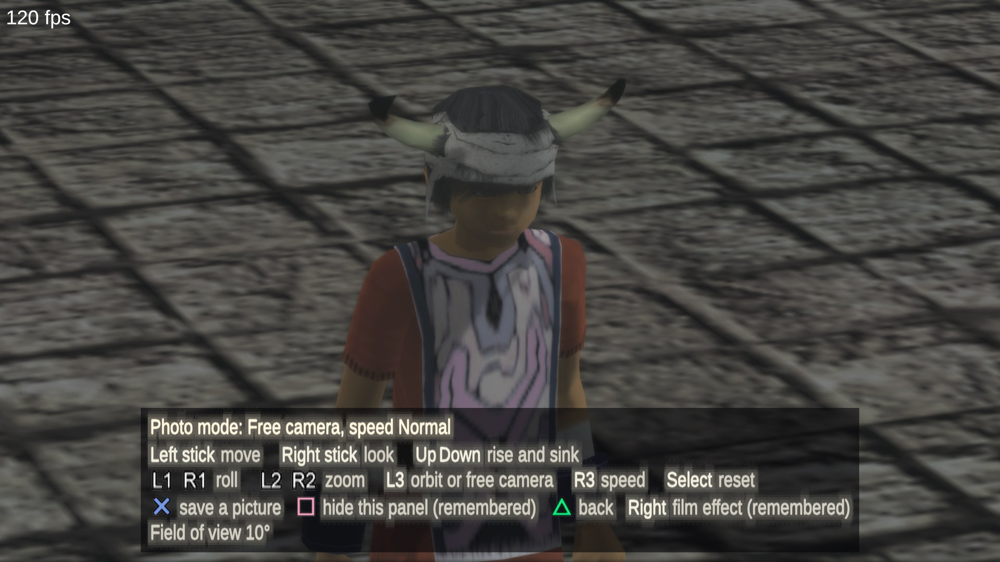
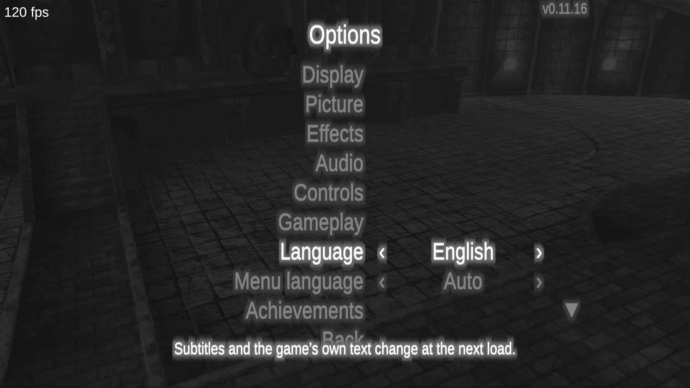
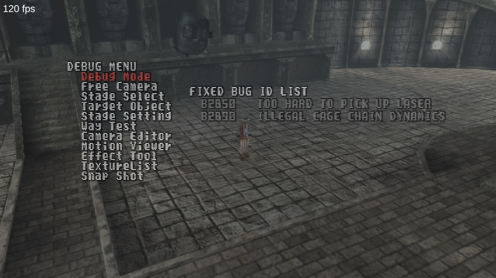

<p align="center">
  
</p>

<p align="center">
  <b>ICO, the PlayStation 2 classic, running its own code<br>
  as a native app for homebrew-enabled PS5 consoles.</b>
</p>

<p align="center">
  <a href="https://prosperostore.net/app/PPSA99031/"></a>
  <a href="https://recompstore.com/game/PPSA99031"></a>
</p>

<p align="center">
  <a href="#install"><b>Install</b></a>
  &nbsp;·&nbsp;
  <a href="#controls">Controls</a>
  &nbsp;·&nbsp;
  <a href="#settings">Settings</a>
  &nbsp;·&nbsp;
  <a href="#reporting-a-bug">Report a bug</a>
</p>

> [!WARNING]
> **Early development build.** This PS5 port is experimental. Expect bugs, crashes and missing
> features.

> [!IMPORTANT]
> **Bring your own game.**
> This project does not include or distribute copyrighted game files. Use an image of your own
> original disc. Please do not request or share game downloads here.

> [!CAUTION]
> **We do not support piracy.**
> Please do not use this project with pirated copies of the game.

<p align="center">
  
  <br>
  <sub>Ico and Yorda on the PS5, rendered at 3840x2160 at 120 fps.</sub>
</p>

## What it is

A PS5 build of [ico-pc](https://github.com/nathanialf/ico-pc), which runs the game's own code as a
normal program instead of emulating the PS2. Here that code is compiled for the PS5's CPU and
draws with Vulkan on its GPU. There is no emulator, BIOS or JIT.

## Highlights

- **4K out of the box.** A new install starts on the Enhanced preset: 3840x2160 in the shape of
  your screen, anisotropic filtering and the full-height picture. The game draws the extra width
  itself; menus and subtitles stay in their 4:3 frame.
- **Up to 120 fps.** Frames are drawn between the game's own, up to your display's refresh rate:
  120 fps on a 120 Hz display, 60 elsewhere.
- **DualSense.** Every button of the DualShock 2, vibration, and the touchpad as Select.
- **Your disc, any region.** The European, Japanese, Korean, North American and Asian discs, the
  August 2001 preview and the June 2001 magazine demo.
- **More languages.** Two Russian translations, by bob-ttz and cobra838, and Brazilian Portuguese
  by ichagas7, next to the European disc's five.
- **Everything from ico-pc:** difficulty modes, photo mode, save states, the CRT filter, colour
  controls and many gameplay options.

<table>
  <tr>
    <td width="50%"><br><sub>The title screen.</sub></td>
    <td width="50%"><br><sub>The opening.</sub></td>
  </tr>
  <tr>
    <td width="50%"><br><sub>Photo mode.</sub></td>
    <td width="50%"><br><sub>Options.</sub></td>
  </tr>
  <tr>
    <td colspan="2" align="center"><br><sub>The makers' debug menu, in Developer mode.</sub></td>
  </tr>
</table>

<sub>Screenshots: ICO on a PS5 with the Enhanced preset and the frame rate counter on, scaled to
1920x1080; otherwise unedited. The game content in them belongs to its owners.</sub>

## Requirements

- A **PS5 that runs homebrew**, with [ShadowMountPlus](https://github.com/drakmor/ShadowMountPlus)
  and an FTP server.
- An image of your own **ICO disc**: `.iso`, `.chd`, or `.bin` with `.cue`. Modified images and
  repacks are refused, as in ico-pc.
- About **1 GB free** on the console.

## Install

You can also install the app from [ProsperoStore](https://prosperostore.net/app/PPSA99031/) or
[RecompStore](https://recompstore.com/game/PPSA99031). You still need your own disc image, as
below.

1. **The app.** Download `PPSA99031.zip` from [Releases](../../releases/latest), unpack it, and
   copy the `PPSA99031` folder to `/data/homebrew/` on the console. The **ICO** tile appears on the
   home screen.
2. **Your disc.** Name the image after your disc and copy it to `/data/ico/PPSA99031/` or
   `/data/ico/`, or to the top or an `ico` folder of a USB drive:

   | Disc | Name |
   |---|---|
   | European (SCES-50760) | `Ico_PAL` |
   | Japanese (SCPS-11003) | `Ico_JPN` |
   | Korean (SCPS-56001) | `Ico_KOR` |
   | North American (SCUS-97113) | `Ico_USA` |
   | Asian (SCPS-55001) | `Ico_CN` |
   | August 2001 preview | `Ico_AUG6` |
   | June 2001 magazine demo | `Ico_JUN26` |

3. **Play.** Start the tile. The first start checks the image and copies the game's files to
   `/data/ico/PPSA99031/ico.o2r`, which takes a few minutes; system notifications show the
   progress. After that you can delete the image.

If the image is missing or not recognised, a notification says why.

**To update,** copy the new `PPSA99031` folder over the old one. Your settings, memory cards and
game files in `/data/ico/PPSA99031/` are kept. Settings saved by an earlier version keep their
preset: pick **Options > Display > Preset > Enhanced** for the 4K picture.

## Controls

The game plays with its own DualShock 2 controls, matched by position on the DualSense.

| DualShock 2 | DualSense |
|---|---|
| Cross / Circle / Square / Triangle | Cross / Circle / Square / Triangle |
| L1 / R1, L2 / R2 | L1 / R1, L2 / R2 |
| D-pad, sticks, stick clicks | the same |
| Start | Options |
| Select | Touchpad click |

Hold **R1** to call Yorda and take her hand; **R2** zooms the camera. One controller is supported;
the game's two-player mode is not.

## Settings

**Options** on the title screen and in the pause menu holds every setting: the preset, resolution
and frame rate, the picture and its effects, controls, gameplay, difficulty and language. Changes
are saved to `/data/ico/PPSA99031/config.toml`. Every row is described in
[docs/OPTIONS.md](docs/OPTIONS.md).

## Your files

Everything the app writes is in `/data/ico/PPSA99031/`: the game archive, settings, memory cards,
caches and `logs/`. **Options > Extras** backs them up to `ico-backup.zip` in the same folder. The
app folder holds only the program, its artwork and its licences.

## Known issues

The whole game has not been played through on a PS5 yet: stability and parity with ico-pc past the
opening are not established.
ico-pc's Windows, Linux, Android and Apple instructions in [docs/](docs/) don't apply to this app.

## Reporting a bug

Open an [issue](../../issues) with the app version, your firmware and disc, what you were doing,
what you expected and what happened, and attach `ico-pc.log` and `last-run.txt` from
`/data/ico/PPSA99031/logs/`. **Never attach game files or disc images.**

## For developers

Build on macOS with Git, Python 3, CMake, Ninja, LLVM 18 and Docker. Every input is pinned in
[port/ps5/dependencies.json](port/ps5/dependencies.json):

```sh
python3 tools/setup-ps5.py --runtime-cache <PS5_Vulkan build> --compiler-rt <libclang_rt.builtins-x86_64.a> --build-images
python3 tools/build-ps5.py
python3 tools/package-ps5.py --pack-python <python with MkPFS 1.1.0>
python3 tools/release-ps5.py
```

`setup-ps5.py` checks the pinned PS5 runtime and fetches the sources, `build-ps5.py` compiles and
links, `package-ps5.py` signs and stages `dist/app`, and `release-ps5.py` makes the store ZIP and
the archive of the GPL sources.

## Credits

- **[nathanialf/ico-pc](https://github.com/nathanialf/ico-pc)** and its contributors: the
  recompilation this port is built on, from the [ICO source reconstruction](https://github.com/nathanialf/ico).
- Translations: bob-ttz and cobra838 (Russian), ichagas7 (Brazilian Portuguese).
- [PS5_Vulkan](https://github.com/mihawk-99/PS5_Vulkan),
  [PS5_Mesa](https://github.com/mihawk-99/PS5_Mesa) (RADV) and
  [PS5_PayloadSDK](https://github.com/mihawk-99/PS5_PayloadSDK) by mihawk-99, SDL3, and the rest in
  [port/ps5/NOTICE.md](port/ps5/NOTICE.md).
- PS5 port: [bystritskiy](https://github.com/bystritskiy).

Problems with the PS5 build belong here, not upstream.

## License

ico-pc and the PS5 host are MIT ([LICENSE](LICENSE)). The PS5 executable links GPL-3.0-or-later
parts of PS5_Vulkan and PayloadSDK, so the built app as a whole is under those terms; each release
carries their source. See [port/ps5/NOTICE.md](port/ps5/NOTICE.md). The game and its assets belong
to their owners and aren't covered by any licence here.

## Legal notice

This is an unofficial, non-commercial fan project, independent of the upstream authors and rights
holders. ICO is a trademark of Sony Interactive Entertainment. PlayStation, PS2, PS5 and DualSense
are trademarks of Sony Interactive Entertainment Inc. All other trademarks belong to their
respective owners.
